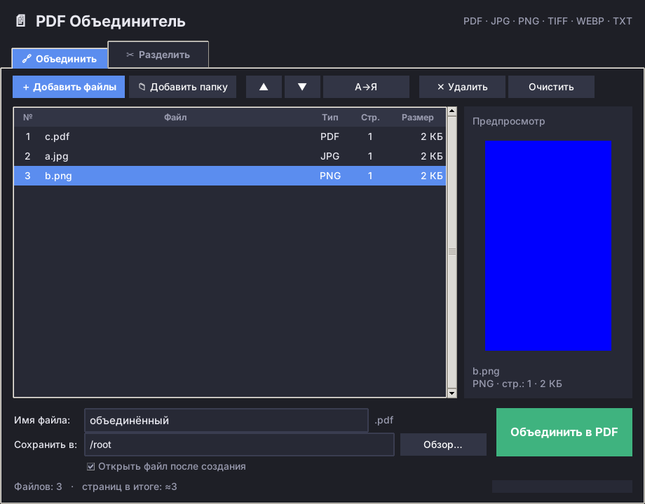
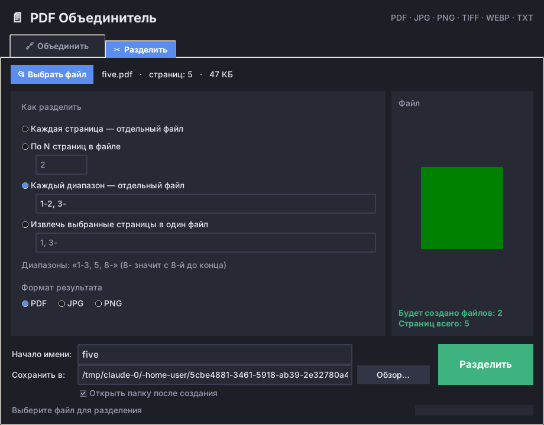
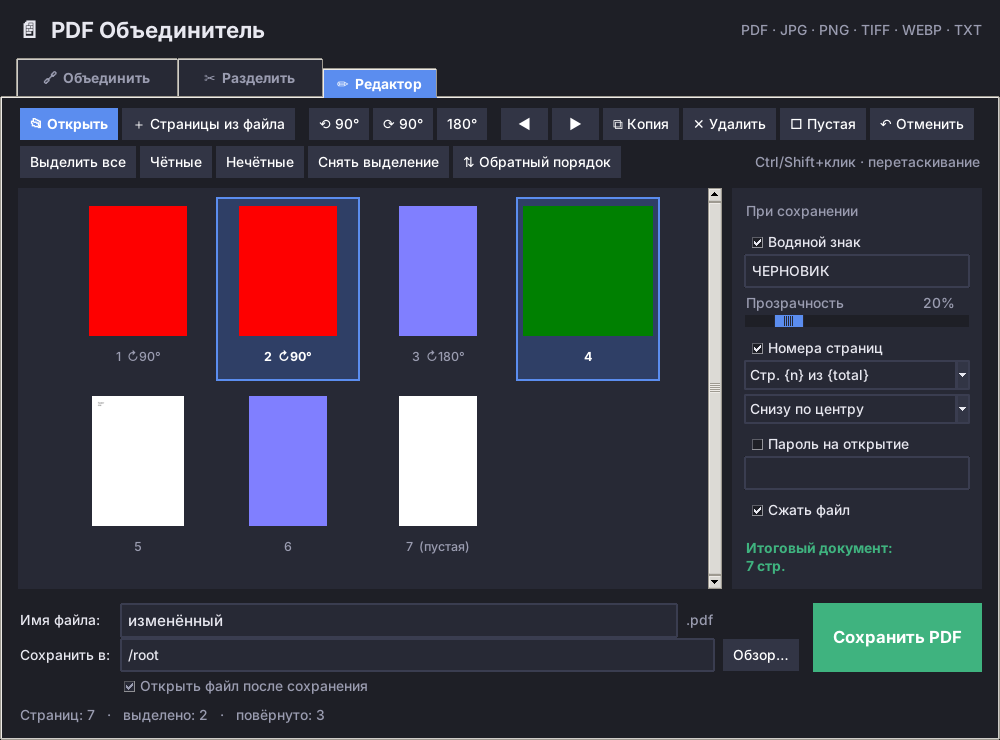

# PDF Объединитель

Программа на Python с графическим интерфейсом для работы с PDF:
**объединение**, **разделение** и **редактирование** страниц.

Поддерживаемые форматы на входе: PDF, JPG/JPEG, PNG, BMP, GIF, TIFF, WEBP, TXT.

## Веб-версия (сервер / Docker)

В репозитории есть `Dockerfile` — платформа соберёт и запустит веб-версию (`app.py`, Streamlit)
автоматически. Приложение слушает `0.0.0.0` и порт из переменной окружения `PORT`
(по умолчанию **8501**).

```bash
docker build -t pdf-app .
docker run -p 8501:8501 pdf-app          # открыть http://localhost:8501
```

Без Docker:

```bash
pip install -r requirements.txt
streamlit run app.py --server.address 0.0.0.0 --server.port 8501
```

В веб-версии те же три вкладки: объединить, разделить, редактор.
Результат скачивается кнопкой «⬇ Скачать» (при разделении на несколько файлов — ZIP-архивом).

## Десктопная версия — установка

Нужен Python 3.9+.

```bash
pip install -r requirements.txt
```

Для перетаскивания файлов мышью из проводника (необязательно):

```bash
pip install tkinterdnd2
```

## Десктопная версия — запуск

```bash
python merge_gui.py
```

Все три файла (`merge_gui.py`, `merge_files.py`, `pdf_edit.py`) должны лежать в одной папке.

## Возможности

### 🔗 Объединить


- Добавление файлов или целой папки, перетаскивание.
- Изменение порядка (мышью, кнопками ▲ ▼, сортировка по имени).
- Предпросмотр, количество страниц и размер каждого файла.
- Свой выбор имени итогового файла и папки сохранения.

### ✂ Разделить


- Каждая страница — отдельный файл.
- По N страниц в файле.
- Каждый диапазон — отдельный файл (`1-3, 5, 8-`).
- Извлечь выбранные страницы в один файл.
- Сохранение в PDF, JPG или PNG.

### ✏ Редактор


- Поворот страниц на 90° / 180°.
- Удаление, копирование, пустые страницы, обратный порядок.
- Перестановка страниц перетаскиванием.
- Вставка страниц из других файлов.
- Выделение всех / чётных / нечётных страниц.
- Отмена действий (Ctrl+Z).
- При сохранении: водяной знак, номера страниц, пароль (AES-256), сжатие.

**Горячие клавиши редактора:** `R` / `Shift+R` — поворот, `Delete` — удалить,
`Ctrl+Z` — отменить, `Ctrl+A` — выделить всё, `Ctrl+D` — копия,
`Alt+←/→` — переместить, `Ctrl+Enter` — сохранить.

## Командная строка

```bash
# объединить
python merge_files.py doc.pdf photo.jpg scan.png -o Мой_документ

# разделить
python merge_files.py split doc.pdf                    # каждая страница отдельно
python merge_files.py split doc.pdf --every 2          # по 2 страницы
python merge_files.py split doc.pdf --ranges "1-3,5"   # каждый диапазон — файл
python merge_files.py split doc.pdf --extract "1,4-6"  # выбранное — в один файл
python merge_files.py split doc.pdf -f jpg             # страницы в картинки
```
